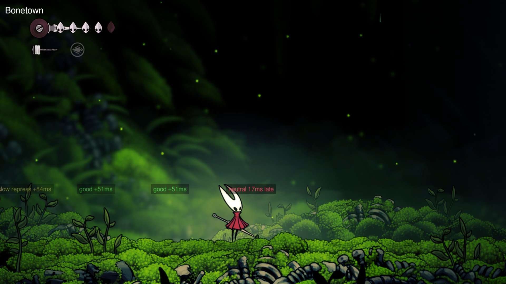
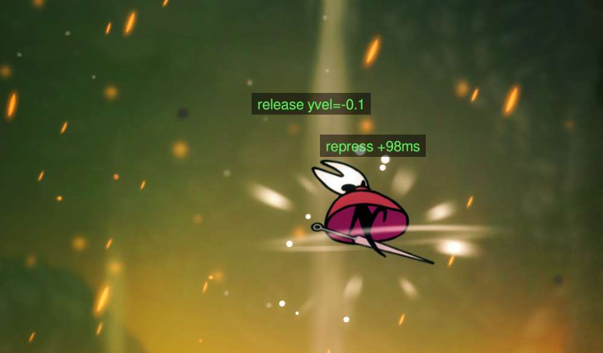

# SpeedrunGym

Contains utilities for speedrun practice. Feature ideas welcome.

Can be configured using BepInEx configuration, e.g. at runtime
using [ConfigurationManager](https://thunderstore.io/c/hollow-knight-silksong/p/jakobhellermann/BepInExConfigurationManager/).

## RNG Normalization

### Craw pogo

Normalize how early the first craw dives.

- `Early` - dive as soon as possible
- `Late1` - dive after one more flap cycle
- `Late2` - dive after two more flap cycles

## Pogo Endlag Detection

When enabled, will display why a pogo endlag cancel failed, or how close it was to being optimal.

Possible popup messages:

- `repress +Xms` - success, re-pressed direction X ms after the neutral landing.
- `jump +Xms` - jumped X ms after the earliest possible jump, shown on a second line.
- `dir repress Xms early` - failed, you pressed a direction X ms too early.
- `neutral Xms late` - you went neutral X ms too late.
- `no neutral` - you never went neutral.

## Jump Timing

Two independently toggleable air-jump readouts, shown as popups next to Hornet.

- `Sprintjump Release` - out of a sprintjump, shows the vertical velocity at the moment you released jump. `yvel ≈ 0`
  means you let go right at the peak, `-` = still gaining height, `+` = falling.
- `Repress` - if you repress jump in order to get float, show how long the repress took

## Silk Waste

Shows a `silk wasted` popup when a hit would have generated silk while your spool is already full.

## Queued Walljump

When enabled, display why queued walljumps failed, or how close to optimal they were.

Possible popup messages:

- `QWJ +0ms` - perfectly pressed at the earliest frame
- `QWJ +21ms` - pressed 21ms after QWJ became possible
- `QWJ +35ms queued 9ms` - the QWJ waited 8ms before firing (usually out of your control?)
- `QWJ 10ms early` - jump was pressed 10ms before the wall came within reach
- `QWJ 0.05u too far` - jump was pressed too early and wall never came within reach
- `QWJ 28ms late, window 21ms` - jump was pressed 28ms after last possible frame. You had a 21ms window.
- `QWJ no direction` - jump would have worked if you hadn't pressed neutral
- `QWJ 18ms late, window 34ms, touching non-slider` - window ended because you're touching a slope
- `WJ +62ms (contact +32ms)` - regular walljump, 62ms after QWJ became possibile, wall contact 32ms

## Training Dummy

Spawns a neutralized grand reed next to Hornet as a training dummy.

- `Contact damage` - `Off`, `EffectOnly` (regular hit, but no HP lost) or `Damage`.
- `Take knockback` - whether attacks knock the dummy back.
